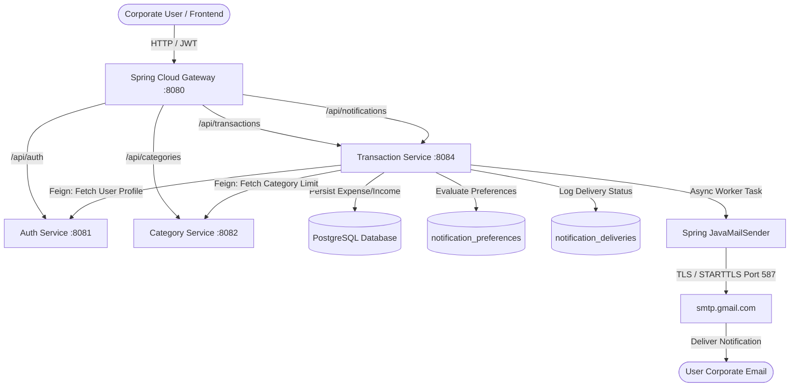

# FinTrack: Gmail SMTP Email Notification Integration Guide

This document describes the design, architecture, setup, testing, and operational management of the **Gmail SMTP Email Notification System** integrated into FinTrack (Corporate Financial Expense Analytics & Budget Reconciliation System).

---

## 1. Architectural Summary

FinTrack is built on a distributed microservices architecture:
- **API Gateway (`8080`)**: Spring Cloud Gateway routing incoming web traffic, enforcing JWT validation, and dispatching `/api/notifications/**` to the notification engine.
- **Eureka Service Registry (`8761`/`9000`)**: Facilitates dynamic service discovery across microservice instances.
- **Auth Service (`8081`)**: Manages corporate user accounts, credential hashing, JWT issuance, and exposes internal user resolution via `GET /api/auth/users/{id}`.
- **Category Service (`8082`)**: Tracks corporate budget lines, spending allocations, and category thresholds.
- **Transaction Service (`8084`)**: Core financial engine managing expenses and incomes. Host to the **FinTrack Notification & Email Engine**, including `EmailService`, `EmailTemplateBuilder`, `NotificationScheduler`, and the delivery tracking repository.
- **Frontend Dashboard (`5173`)**: React 18 + Vite SPA styled with TailwindCSS and Vanilla CSS, featuring deep navy and emerald corporate aesthetics, real-time live engine indicators, persistent user preferences, and a diagnostic test-email tool.



---

## 2. Setting Up Gmail 2-Step Verification & App Passwords

> [!IMPORTANT]
> Google **does not allow** standard Google account passwords for SMTP authentication due to security restrictions. You **must** generate a dedicated 16-character **Google App Password**.

### Step 1: Enable 2-Step Verification
1. Sign in to your dedicated FinTrack sender Google account at [myaccount.google.com](https://myaccount.google.com).
2. In the left navigation menu, select **Security**.
3. Under the *How you sign in to Google* section, select **2-Step Verification**.
4. Follow the on-screen prompts to configure an authenticator app, hardware key, or phone number.
5. Ensure 2-Step Verification shows as **ON**.

*Note: For Google Workspace accounts (corporate domains), the Google Workspace super-administrator must permit users to enable 2-Step Verification and App Passwords in the Admin Console under Security > Access and data control.*

### Step 2: Generate an App Password
1. Navigate to [myaccount.google.com/apppasswords](https://myaccount.google.com/apppasswords).
2. Enter an identifiable name for the application (e.g., `FinTrack Notifications`).
3. Click **Create**.
4. Google will display a **16-character passcode** formatted in 4-character blocks (e.g., `abcd efgh ijkl mnop`).
5. Copy this string. Remove spaces when placing into your configuration: `abcdefghijklmnop`.
6. Click **Done**.

### Step 3: Revoking an App Password
If credentials are leaked or need rotation:
1. Re-open [myaccount.google.com/apppasswords](https://myaccount.google.com/apppasswords).
2. Find `FinTrack Notifications` in the list of active App Passwords.
3. Click the **Trash / Revoke** icon immediately.

---

## 3. Environment Variables Configuration

The notification service reads configuration via standard Spring Boot environment properties. 

| Variable | Recommended Default | Description |
| :--- | :--- | :--- |
| `SMTP_HOST` | `smtp.gmail.com` | Hostname of Google's SMTP submission server |
| `SMTP_PORT` | `587` | Port 587 (STARTTLS) or 465 (SSL) |
| `SMTP_USERNAME` | `fintrack.notifications@gmail.com` | Authenticating Gmail address |
| `SMTP_PASSWORD` | *(16-char App Password)* | Google App Password (**never commit to git**) |
| `SMTP_FROM_EMAIL` | `fintrack.notifications@gmail.com` | Outbound sender address |
| `SMTP_ENABLED` | `false` | Master circuit-breaker flag (`true` to enable outbound email) |
| `FINTRACK_APP_URL` | `http://localhost:5173` | Base frontend URL included in email action buttons |

### Backend `.env` / Application Environment Configuration
```env
SMTP_HOST=smtp.gmail.com
SMTP_PORT=587
SMTP_USERNAME=fintrack.notifications@gmail.com
SMTP_PASSWORD=abcdefghijklmnop
SMTP_FROM_EMAIL=fintrack.notifications@gmail.com
SMTP_ENABLED=false
FINTRACK_APP_URL=http://localhost:5173
```

---

## 4. Local Development Instructions

### Prerequisites
- Java 17+ (or Java 21 / 25)
- Node.js 18+
- PostgreSQL database (or Supabase instance)

### Running Microservices Locally
1. **Start Eureka Server**:
   ```bash
   cd backend/eureka-server
   ..\..\mvnw.cmd spring-boot:run
   ```
2. **Start API Gateway**:
   ```bash
   cd backend/api-gateway
   ..\..\mvnw.cmd spring-boot:run
   ```
3. **Start Auth Service**:
   ```bash
   cd backend/auth-service
   ..\..\mvnw.cmd spring-boot:run
   ```
4. **Start Transaction Service** (with SMTP configuration):
   ```bash
   cd backend/transaction-service
   set SMTP_ENABLED=true
   set SMTP_USERNAME=your_sender@gmail.com
   set SMTP_PASSWORD=your_app_password
   set SMTP_FROM_EMAIL=your_sender@gmail.com
   ..\..\mvnw.cmd spring-boot:run
   ```
5. **Start Frontend Dashboard**:
   ```bash
   cd frontend
   npm run dev
   ```

---

## 5. Event Integrations & Business Rules

### A. Budget Threshold Alerts (80%, 100%, Over-Budget)
- Triggered automatically whenever a financial expense is recorded in `TransactionServiceImpl`.
- Aggregates current month-to-date spending for that category from PostgreSQL (`sumAmountByUserIdAndTypeAndDateRange`).
- Compares against category limit fetched from `CategoryClient`.
- **Deduplication Engine**: Formats a deterministic idempotency key `budget-{userId}-{catId}-{period}-{threshold}`. Prevents sending multiple 80% emails within the same `YYYY-MM` billing period. Resets automatically on the 1st of each month.

### B. Expense & Income Notifications
- Dispatched only after the transaction commits to the primary database.
- Respects `expenseConfirmationsEnabled` and `incomeNotificationsEnabled` user preferences.
- Displays amount in Indian Rupee format (`₹ 15,450.00`), category, payment method, and date.

### C. Savings Goal Milestones & Deadline Reminders
- Triggered upon contributions via `POST /api/notifications/savings-goals/event`.
- Milestones: Sends celebration alerts at **25%**, **50%**, **75%**, and **100%** completion.
- Milestone deduplication prevents redundant emails using `goal-milestone-{userId}-{goalId}-{milestone}` idempotency checks.
- Deadline warning alerts notify users when a savings goal deadline is approaching.

### D. Monthly Financial Summary
- Automated background cron scheduled for the 1st of every month at 08:00 AM (`@Scheduled(cron = "0 0 8 1 * ?")`).
- Aggregates total monthly income, expenses, net cash flow, savings rate percentage, and top expense categories.

---

## 6. Delivery Tracking & Database Schema

Every dispatch attempt is audited in the `notification_deliveries` table:

```sql
CREATE TABLE notification_deliveries (
    id BIGSERIAL PRIMARY KEY,
    user_id BIGINT NOT NULL,
    recipient_email VARCHAR(255) NOT NULL,
    notification_type VARCHAR(50) NOT NULL,
    subject VARCHAR(255) NOT NULL,
    status VARCHAR(20) NOT NULL, -- PENDING, SENT, FAILED, SKIPPED_DISABLED
    attempt_count INT DEFAULT 0,
    idempotency_key VARCHAR(255) UNIQUE,
    error_category VARCHAR(100),
    error_message TEXT,
    created_at TIMESTAMP WITHOUT TIME ZONE DEFAULT NOW(),
    last_attempt_at TIMESTAMP WITHOUT TIME ZONE
);
```

### Safety & Fault Tolerance
- **Non-blocking Execution**: Email delivery runs asynchronously in a dedicated `notificationExecutor` thread pool.
- **Fail-Safe Processing**: An SMTP network exception or timeout **never** rolls back or aborts an expense or income transaction.
- **Sanitized Logging**: Passwords, app keys, and JWT authorization headers are strictly excluded from log statements. Recipient emails are masked in application logs (e.g., `h****a@fintrack.com`).

---

## 7. Step-by-Step Manual Verification Procedure

### Test 1: Send Diagnostic Test Email
1. Sign in to the FinTrack dashboard at `http://localhost:5173`.
2. Open the **Notifications Menu** by clicking the bell icon in the top navigation bar.
3. Verify that **Enable Gmail SMTP Notifications** is switched ON.
4. Click **Send Test Email**.
5. Observe the live diagnostic response banner.
6. Check your verified Gmail inbox for the incoming FinTrack Test Verification email with responsive HTML formatting and security stamp.

### Test 2: Verify Rate Limiting
1. Click **Send Test Email** 4 times consecutively.
2. Verify that the 4th attempt returns HTTP 429: *"Test email rate limit reached (max 3 per hour)"*.
3. Verify that the user interface displays the rate limit warning without crashing.

### Test 3: Budget 80% Threshold Breach
1. Navigate to **Transactions** > **Add Transaction**.
2. Select an expense category with a ₹10,000 budget limit (e.g., *Dining Out*).
3. Record an expense of ₹8,500.
4. Verify that:
   - The expense saves successfully.
   - An in-app alert appears in the notification drawer: *"Dining Out has reached 85% of monthly budget"*.
   - A branded HTML email is dispatched to the user's registered email address.
5. Record a second expense of ₹200 in the same category.
6. Verify that the expense saves, but no duplicate 80% email is sent because the deduplication key already exists for the current month.

### Test 4: Disable SMTP Circuit Breaker
1. Set `SMTP_ENABLED=false` in the backend environment.
2. Record an expense or test email.
3. Verify that `notification_deliveries` logs status `SKIPPED_DISABLED` with zero delivery errors, and user operations proceed uninterrupted.

---

## 8. Troubleshooting Guide

| Issue | Error Category | Probable Cause | Resolution |
| :--- | :--- | :--- | :--- |
| **535-5.7.8 Username and Password not accepted** | `AUTH_FAILURE` | Invalid App Password or standard Google password used. | Confirm 2-Step Verification is active and generate a new 16-character App Password at `myaccount.google.com/apppasswords`. |
| **Could not connect to SMTP host: smtp.gmail.com, port: 587** | `CONNECTION_ERROR` | Firewall or ISP blocking port 587 outbound, or DNS resolution failure. | Verify network connectivity: `Test-NetConnection smtp.gmail.com -Port 587`. Alternatively, switch to port `465` with SSL. |
| **Read timed out / Connection timed out** | `TIMEOUT` | Network latency exceeded socket timeout thresholds. | Socket timeout is configured for 10,000ms. Check proxy/VPN configurations. Retry logic will automatically attempt redelivery. |
| **Invalid Addresses / 550 5.1.1** | `INVALID_RECIPIENT` | Malformed or nonexistent email address associated with the user account. | Verify user email address in `Auth Service` (`users` table). Check formatting. |
| **Daily user sending quota exceeded** | `RATE_LIMITED` | Gmail free accounts have a limit of 500 emails/day; Workspace accounts have 2,000 emails/day. | For enterprise scale exceeding 2,000 emails/day, transition to AWS SES, SendGrid, or Brevo SMTP relay. |

---

## 9. Automated Test Suite Results

The automated test suite runs via JUnit 5 and Mockito with zero live SMTP dependencies.

```bash
cd backend/transaction-service
..\..\mvnw.cmd test
```

### Test Coverage Summary
- `EmailTemplateBuilderTest`: Validates HTML formatting, XSS escaping, INR currency representation, plain-text fallback generation, and template rendering across all 5 notification types (9 tests).
- `EmailServiceImplTest`: Validates JavaMailSender dispatch, circuit-breaker disabled handling, retry handling for transient exceptions, and sanitization (5 tests).
- `NotificationServiceImplTest`: Validates budget threshold triggers, monthly period deduplication, preference opt-out, savings goal milestones, rate limiting, and fault tolerance against SMTP crashes (6 tests).

**Test Execution Outcome:**
```text
[INFO] Running com.spendwise.transaction.service.EmailTemplateBuilderTest
[INFO] Tests run: 9, Failures: 0, Errors: 0, Skipped: 0
[INFO] Running com.spendwise.transaction.service.EmailServiceImplTest
[INFO] Tests run: 5, Failures: 0, Errors: 0, Skipped: 0
[INFO] Running com.spendwise.transaction.service.NotificationServiceImplTest
[INFO] Tests run: 6, Failures: 0, Errors: 0, Skipped: 0
[INFO] ------------------------------------------------------------------------
[INFO] BUILD SUCCESS - Tests run: 20, Failures: 0, Errors: 0, Skipped: 0
[INFO] ------------------------------------------------------------------------
```

---

## 10. Architectural Limitations & Production Recommendations

1. **In-Memory Thread Pool vs Distributed Queue**:
   - Current implementation utilizes Spring's `@Async` backed by `ThreadPoolTaskExecutor`. This provides zero additional infrastructure overhead for single-instance or small cluster setups.
   - For high-volume enterprise deployments with dozens of concurrent service instances, consider integrating an external message broker (RabbitMQ or Apache Kafka) with dedicated worker consumers.
2. **Gmail SMTP Limitations**:
   - Gmail SMTP is intended for low-to-medium volume notification traffic (maximum 500 emails/day for standard Gmail accounts, 2,000/day for Google Workspace).
   - If FinTrack scales beyond thousands of automated transactions daily, route traffic through a specialized transactional email provider (Amazon SES, Postmark, or SendGrid) by updating `SMTP_HOST`, `SMTP_PORT`, and credentials in `render.yaml`.
